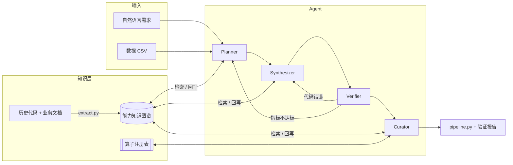
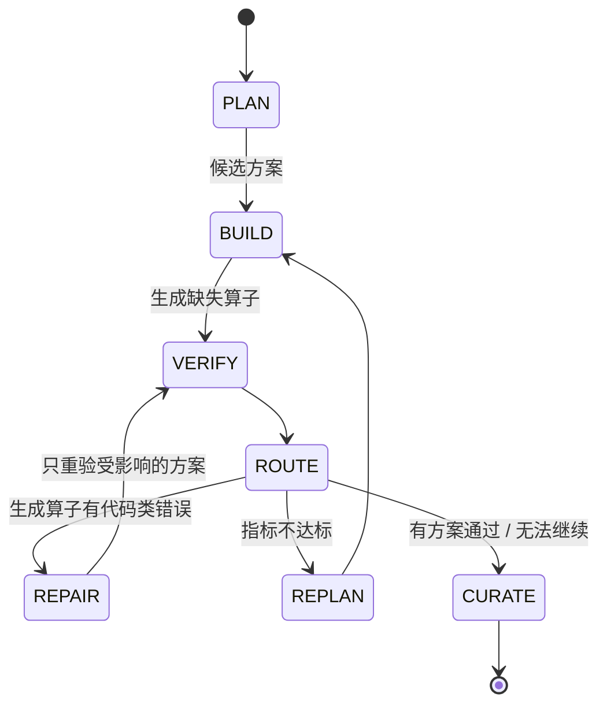

# AlgoForge：基于 AI Agent 的算法能力工厂

把散落在**历史代码仓库与业务文档**中的算法经验抽取成**能力知识图谱**，再由多个 Agent 协作，把一句自然语言能力描述**复刻**成可运行、经过**四级自动验证**的算法代码，并把验证结果、新生成的算子和修复经验**沉淀**回知识图谱，供下一次复用。

```
能力抽取 ──▶ 能力复刻（Reuse / Synthesize）──▶ 自动验证 ──▶ 修复优化 ──▶ 知识沉淀
   ▲                                                                     │
   └──────────────────────── 下一次运行直接复用 ◀─────────────────────────┘
```

**30 秒体验（离线、无需 API Key）**

```bash
conda env create -f environment.yml && conda activate algoforge
python -m factory.cli demo          # 回放录制的 LLM 响应，约 1 分钟跑完 3 个任务
streamlit run app.py                # Web 界面
```

| 运行（`examples/demo/`） | 演示内容 | 结果 |
| --- | --- | --- |
| [01 工单文本分类](examples/demo/runs/01_tickets_transfer/report.md) | 跨场景迁移：无场景知识，靠通用经验（中文用字符级 TF-IDF）规划，两个候选都是纯文本流水线 | F1-macro 0.828 ✅ |
| [02 客户流失（3 个候选）](examples/demo/runs/02_churn_synthesize/report.md) | 生成 4 个算子（清洗、分箱、比值特征、平衡 LightGBM）；3 个候选比较，最优方案通过后注册 `TotalChargesCleaner@2`、`TenureBucketizer@2` | recall 0.778 ✅ |
| [03 客户流失（相似需求）](examples/demo/runs/03_churn_reuse/report.md) | 直接复用 02 注册的两个算子 | recall 0.778 ✅ |

---

## 目录

1. [项目背景和目标](#1-项目背景和目标)
2. [系统架构和模块设计](#2-系统架构和模块设计)
3. [能力知识图谱 schema 和示例](#3-能力知识图谱-schema-和示例)
4. [Agent 工作流设计](#4-agent-工作流设计)
5. [环境配置和运行方法](#5-环境配置和运行方法)
6. [示例数据和测试任务说明](#6-示例数据和测试任务说明)
7. [生成算法代码示例](#7-生成算法代码示例)
8. [验证结果和报告样例](#8-验证结果和报告样例)
9. [遇到的挑战和解决方案](#9-遇到的挑战和解决方案)
10. [后续可扩展方向](#10-后续可扩展方向)

---

## 1. 项目背景和目标

企业的算法能力往往分散在旧代码、实验记录、失败复盘和调参经验里，每个新需求都要重新理解、重新写、重新踩坑。本项目实现一个小型"算法能力工厂"原型，验证以下闭环：

| 环节 | 本项目的做法 |
| --- | --- |
| 能力抽取 | 用 `ast` 解析历史代码的函数、签名、依赖与源码，LLM 归纳为能力卡片；LLM 从业务文档抽取指标、约束、历史实验和经验教训，写入知识图谱 |
| 能力复刻 | 能力的单位是**算子（Operator）**。对需求的每个步骤，知识图谱里已有可执行算子就 **Reuse**；没有就由 LLM 参考抽取到的历史实现 **Synthesize** 一个新算子 |
| 能力验证 | 静态检查 → 沙箱执行 → 契约检查 → 指标检查，任一级失败都给出带诊断码的结构化诊断 |
| 修复优化 | 代码类错误只修复出错的那个算子（带上同诊断码的历史经验）；指标不达标则带着诊断重新规划 |
| 能力沉淀 | 验证通过的新算子注册进能力库；验证结果、修复经验回写知识图谱；下次运行检索时直接用上 |

选择的行业场景：**电信客户流失预测**（表格二分类，主场景）与**客服工单分类**（中文文本多分类，验证跨场景迁移）。

## 2. 系统架构和模块设计

设计参照 PyTorch / DataFlow 的算子库思想：

| PyTorch | 本项目 |
| --- | --- |
| `nn.Module` | `Operator`：sklearn 兼容（`fit/transform` 或 `fit/predict`），并声明类型、输入输出、适用条件、依赖、版本 |
| `nn.Sequential` | `Pipeline`：直接使用 `sklearn.pipeline.Pipeline` 组合算子 |
| `torchvision.models` 注册表 | `OperatorRegistry` + 能力知识图谱 |



```
├── factory/
│   ├── schemas.py          # 三层中间表示 TaskSpec / PipelinePlan / 代码，诊断码，RunState
│   ├── operators/          # Operator 基类与注册表、7 个内置算子、生成算子的加载与持久化
│   ├── llm.py              # OpenAI 兼容客户端、结构化输出校验与重试、缓存、录制回放、MockLLM
│   ├── extract.py          # 能力抽取：AST + LLM → 知识图谱
│   ├── kg.py / kg_viz.py   # 知识图谱存储、检索、导出、可视化
│   ├── profile.py          # 数据画像：列角色与适用条件标签（确定性）
│   ├── agents/             # planner / synthesizer / curator，rules.py 为离线规则版
│   ├── verify/             # static / sandbox / checks 四级验证，按任务类型读取配置
│   ├── workflow.py         # 状态机
│   ├── codegen.py          # 方案 → 可独立运行的 pipeline.py
│   ├── report.py           # Markdown / HTML 验证报告
│   ├── demo.py / cli.py    # 演示与命令行
├── app.py                  # Streamlit 界面
├── configs/                # llm.yaml；tasks/*.yaml 为各任务类型的验证配置
├── data/                   # 示例数据与模拟业务材料（见 data/README.md）
├── kg/                     # 抽取得到的知识图谱（JSON / GraphML / HTML）与原始抽取结果
├── examples/               # 录制的 LLM 响应（cassettes）与演示产物
├── docs/                   # schema.md、roadmap.md
└── tests/                  # 90 个测试
```

**技术选型与理由**

| 选择 | 理由 |
| --- | --- |
| 自研状态机（约 330 行），不用 LangGraph / AutoGen | 状态转移一目了然，便于测试和调试；依赖少，复现简单 |
| NetworkX + JSON/GraphML，不用 Neo4j | 原型规模下无需部署数据库；GraphML 可直接导入 Gephi / Neo4j |
| BM25+（rank-bm25） | 轻量、可解释、无需向量模型；中文按字 + 二元组切分 |
| pydantic | 每一层 LLM 输出都有 schema，可单独校验和测试 |
| sklearn 接口的算子 | 直接复用 sklearn 的 Pipeline、clone、交叉验证生态 |
| OpenAI 兼容接口 + 录制回放 | 可换任意模型；评审无需 API Key 也能完整复现 |
| Streamlit + pyvis | 少量代码即可得到可交互的界面与图谱 |

## 3. 能力知识图谱 schema 和示例

完整说明见 [docs/schema.md](docs/schema.md)。

- **8 类节点**：`Scenario`（场景）、`Operator`（算子，带版本与是否可执行）、`Metric`、`Condition`（适用条件）、`Dependency`、`ValidationRun`（验证记录）、`Lesson`（经验，带诊断码）、`Source`（出处）
- **9 类边**：`SUITABLE_WHEN`、`DEPENDS_ON`、`EVALUATED_BY{threshold}`、`VALIDATED_BY{metric}`、`RUN_ON`、`LEARNED_FROM`、`APPLIES_TO`、`EXTRACTED_FROM`、`DERIVED_FROM`（版本谱系）
- **检索**：结构化过滤（类型、模态、可执行） → `0.4 × BM25+ 文本 + 0.3 × 条件匹配 + 0.3 × 历史验证分`，每条结果带分项得分和证据；作废的历史实验（如数据泄漏）不计入历史分

**可视化**：`python -m factory.cli kg viz` 默认生成**概览**，只画场景 / 指标 / 算子 / 经验四类主干节点。适用条件、依赖、出处折叠在节点的悬停信息里；验证记录汇总为"算子 → 场景"的一条边（线越粗，验证次数越多）。演示后的图谱在概览中是 33 个节点 / 39 条边，完整视图是 81 / 174。命令会同时写出概览 `capability_kg.html` 与完整视图 `capability_kg_full.html`（含 ValidationRun、Source、Condition、Dependency），页面顶部可互相跳转；`--focus <节点 id>` 只看某个节点的邻域。Web 界面里三种视图都可以切换。

| 文件 | 内容 |
| --- | --- |
| [`kg/capability_kg.json`](kg/capability_kg.json) / `.graphml` / [概览 `.html`](kg/capability_kg.html) / [完整 `_full.html`](kg/capability_kg_full.html) | 抽取得到的基础知识图谱：14 个算子、10 条经验（已合并重复）、5 条历史实验 |
| [`kg/extraction.json`](kg/extraction.json) | LLM 的原始抽取结果（能力卡片、文档知识） |
| [`examples/demo/kg/`](examples/demo/kg/) | 演示 3 个任务后的知识图谱：算子 14 → 17、验证记录 5 → 12、场景 1 → 2；`operators/` 下是沉淀的生成算子源码 |

示例：从失败复盘中抽取的经验，以及演示中由修复过程提炼的新经验

```json
{"type": "Lesson", "title": "数值列含空白字符导致类型转换失败", "error_code": "E_RUNTIME",
 "trigger": "新入网客户累计消费为空白字符串，转 float 时抛出 ValueError: could not convert string to float: ' '",
 "fix": "先 str.strip()，再 pd.to_numeric(errors='coerce')，缺失值填补为 0"}
{"type": "Lesson", "title": "样本不平衡导致默认模型召回率偏低", "error_code": "M_THRESHOLD",
 "trigger": "默认 0.5 阈值下 recall 只有 0.55 左右，正负样本约 1:3", "fix": "class_weight='balanced'，或在验证集上调阈值以满足最低召回",
 "aliases": ["样本不平衡导致默认阈值下召回率偏低"]}
```

最后一条由两份文档分别抽取，内容重复，写入时自动合并为一条（`aliases` 保留被合并的标题，边合并到同一条经验上）。

## 4. Agent 工作流设计

四个 Agent 通过共享状态 `RunState` 协作，由 `factory/workflow.py` 中的显式状态机调度：



| Agent | 职责 | LLM |
| --- | --- | --- |
| **Planner** | 需求 + 数据画像 → `TaskSpec`；按步骤检索知识图谱；给出 N 个候选 `PipelinePlan`，每步说明 Reuse 还是 Synthesize 及理由 | 是 |
| **Synthesizer** | 按 `SynthSpec` 生成算子代码（有历史实现时参考它）；按诊断修复 | 是 |
| **Verifier** | 四级验证，输出结构化诊断（确定性，不调用 LLM） | 否 |
| **Curator** | 注册新算子、回写验证结果、把"诊断 → 修复"提炼为 Lesson | 仅提炼经验 |

三个设计要点：

1. **分层结构化规划**（借鉴编译器的分层中间表示）：`TaskSpec`（做什么）→ `PipelinePlan`（怎么做）→ 代码。LLM 的每次输出都要通过 pydantic schema 和语义检查（算子是否存在、参数是否合法、模态是否匹配、阈值是否有出处），不通过就带着错误信息让 LLM 重写。
2. **知识驱动的能力组合**：规划时检索候选算子和经验，报告中能看到每个选择的分项得分和证据；抽取到的历史代码作为生成新算子的参考。
3. **诊断驱动的自修复与经验复用**：诊断码分为代码类（`E_*`，只修复出错的算子）和指标类（`M_*`，重新规划）；修复时检索同诊断码的 Lesson；修复成功后提炼成新 Lesson；先修复所有可修复的候选，再公平选优。

**四级验证**（`factory/verify/`，配置见 `configs/tasks/*.yaml`）

| 级别 | 检查 | 诊断码 |
| --- | --- | --- |
| 1 静态检查 | 语法；import 白名单；禁止 `eval/exec/open/getattr/__dunder__` 等；接口齐全；`meta.params` 与 `__init__` 默认值一致 | `E_SYNTAX` `E_UNSAFE` `E_INTERFACE` |
| 2 沙箱执行 | 独立子进程，限制超时与内存，清除含 KEY/TOKEN/SECRET 的环境变量，小样本冒烟并定位到出错算子 | `E_RUNTIME` `E_TIMEOUT` |
| 3 契约检查 | 不修改输入；行数一致；不新引入 NaN/Inf；`predict_proba` 为合法概率的 ndarray；能处理未见类别与缺失值 | `E_MUTATION` `E_SHAPE` `E_NAN` `E_PROBA` |
| 4 指标检查 | 多种子 × 分层 K 折交叉验证；阈值；种子间稳定性；指标过高疑似泄漏；耗时与内存 | `M_THRESHOLD` `M_UNSTABLE` |

评估指标以插件方式注册（`@metric("name")`），新的任务类型只需新增一个 `configs/tasks/<task_type>.yaml`。

## 5. 环境配置和运行方法

```bash
# 1. 环境（Miniconda3）
conda env create -f environment.yml      # 创建 algoforge 环境（Python 3.11），并以可编辑方式安装 factory 包
conda activate algoforge

# 2. （可选）真实 LLM：复制 .env.example 为 .env 并填写 LLM_API_KEY
cp .env.example .env
python -m factory.cli llm-ping           # 检查连通性并列出可用模型（不会打印 Key）
```

**Windows**：原生 Windows 可直接运行（已移除对 Linux `resource` 模块与 `preexec_fn` 的硬依赖）。沙箱的内存上限在 Linux/macOS 上由内核 `RLIMIT_AS` 强制，在 Windows 上由父进程用 psutil 轮询子进程内存、超限即终止；超时限制两者一致。已有环境请执行 `conda env update -f environment.yml` 安装新增的 psutil。

API Key 只从 `.env` 读取（已加入 `.gitignore`），在报错中脱敏，不会写进缓存与录制文件；沙箱子进程中也会清除。`tests/test_secrets.py` 会扫描所有将被提交的文件。

**LLM 模式**：`--llm replay`（默认用于演示，回放 `examples/cassettes/`，完全离线）、`live`（真实调用，带磁盘缓存）、`record`（真实调用并录制）、`mock`（规则版 Agent，用于测试）。默认模型 `gemini-3.5-flash`，可在 `configs/llm.yaml` 或 `.env` 的 `LLM_MODEL` 中修改，任意 OpenAI 兼容接口均可。

| 命令 | 说明 |
| --- | --- |
| `python -m factory.cli demo` | 端到端演示（3 个任务），输出到 `runs/demo/` |
| `python -m factory.cli run "<需求>" --data data/churn.csv` | 端到端运行；`--candidates 3`、`--no-synthesis`、`--no-writeback`、`--kg <路径>` |
| `python -m factory.cli extract` | 从 `data/materials/` 抽取能力，重建 `kg/` |
| `python -m factory.cli kg stats / search / lessons / viz` | 统计、检索算子、检索经验、生成可视化 HTML（概览 + 完整两个文件；`--focus` 只看邻域） |
| `python -m factory.cli report runs/<id>` | 根据 `state.json` 重新生成报告 |
| `python -m factory.cli operators` | 列出已注册算子 |
| `streamlit run app.py` | Web 界面：运行（实时进度、报告、代码下载）、能力库与可交互图谱、历史运行 |
| `pytest` / `pytest -m slow` | 89 个常规测试（约 1 分钟）/ 完整演示回放测试 |

> `run` 默认把结果写回 `kg/capability_kg.json`。只想试用时加 `--no-writeback`，或用 `--kg` 指向一份副本；Web 界面默认在副本上运行。

## 6. 示例数据和测试任务说明

数据与材料都由脚本生成、随机种子固定（详见 [data/README.md](data/README.md)）：

| 数据 / 材料 | 说明 |
| --- | --- |
| `data/churn.csv` | 5000 行电信客户数据，流失率 26.6%。保留了真实数据常见的脏点：`total_charges` 是字符串且新客户为空白、部分列缺失、高基数 `customer_id` |
| `data/tickets.csv` | 2000 条中文客服工单，4 类、不均衡，含跨类表述与约 6% 标签噪声 |
| `data/materials/legacy_repo/` | 模拟的历史代码仓库 `churn_v1`：清洗、特征、目标编码、LightGBM、阈值调整、recall@k 等 9 个函数 |
| `data/materials/docs/` | 需求说明、实验记录、失败复盘、调参经验 4 篇文档 |

| 测试任务 | 需求 | 考察点 |
| --- | --- | --- |
| 客户流失 | "预测30天内可能流失的客户，需可解释，召回优先" | 阈值来自知识图谱中的需求文档（recall ≥ 0.75）；脏数据需要生成清洗算子；可解释约束偏向线性模型 |
| 客户流失（相似需求） | "预测下个月可能流失的客户，要能解释原因，尽量不漏掉流失客户" | 复用上一次沉淀的算子 |
| 工单分类 | "把客服工单自动分到四类，宏平均 F1 不低于 0.8" | 跨场景迁移：新场景无场景知识，依靠通用经验（中文用字符级 TF-IDF） |

## 7. 生成算法代码示例

每次运行都会导出可独立运行的 `pipeline.py`：复用的内置算子以 import 引用，生成的算子源码直接内嵌，每一步附上 Planner 的理由。以 [03 客户流失（复用）](examples/demo/runs/03_churn_reuse/pipeline.py) 为例：

```python
def build_pipeline() -> Pipeline:
    return Pipeline([
        ("0_feature", IdColumnDropper()),  # 根据经验提示，customer_id基数过高，直接编码会导致维度暴涨与内存溢出，需在预处理前剔除。
        ("1_imputer", TotalChargesCleaner(column='total_charges', fill_value=0.0)),  # 根据经验提示，total_charges列存在空白字符脏数据…
        ("2_imputer", MissingValueImputer()),  # 处理 monthly_charges 与 payment_method 列的缺失值，保证数据完整性。
        ("3_feature", TenureBucketizer(input_col='tenure', ..., bins=(-1, 6, 12, 24, 48, float('inf')), ...)),
        ("4_encoder", OneHotCategoricalEncoder(max_categories=20)),
        ("5_scaler", StandardFeatureScaler()),
        ("6_model", LogisticRegressionModel(C=1.0, class_weight='balanced', max_iter=1000, random_state=42)),
    ])
```

```bash
python examples/demo/runs/03_churn_reuse/pipeline.py --data data/churn.csv            # 训练并保存 model.joblib
python examples/demo/runs/03_churn_reuse/pipeline.py --predict data/churn.csv          # 预测
```

其中 `TotalChargesCleaner@2`、`TenureBucketizer@2` 是第 02 个任务由 LLM 参考历史代码生成、验证通过后注册的算子（源码在 [`examples/demo/kg/operators/`](examples/demo/kg/operators/)）。

**修复示例**：录制好的演示中没有出现代码类错误，因此没有修复记录——多次真实运行中，LLM 有时会生成带缺陷的算子（下面两例），有时直接给出纯复用方案。修复闭环由 `tests/test_synthesis.py` 的 mock 用例完整覆盖（生成 → 失败 → 修复 → 通过 → 注册 → 提炼经验），其中的 LLM 响应是确定性的。真实的修复记录（`E_SHAPE`、`E_UNSAFE` 各一次）来自开发时的真实 API 运行，修复时 LLM 拿到的内容如下：

| 诊断 | 修复 |
| --- | --- |
| `E_SHAPE` `BalancedLightGBMClassifier` 的 `predict_proba` 返回了 DataFrame | 改为返回 `numpy` 数组 |
| `E_UNSAFE` 禁止调用 `getattr()` | `getattr(self, "x_", [])` → `try: self.x_ except AttributeError:` |

## 8. 验证结果和报告样例

每次运行在运行目录生成 `report.md` 与 `report.html`（同一份内容的两种渲染）：概要、需求理解、知识检索的分项得分与证据、候选比较（均值 ± 种子间标准差、指标条形图）、最优方案每一步的理由、生成算子与修复 diff、四级验证配置与资源消耗、知识沉淀、生成的代码与运行记录。

样例：[任务 02 报告](examples/demo/runs/02_churn_synthesize/report.md)（[HTML](examples/demo/runs/02_churn_synthesize/report.html)），节选：

| 排名 | 方案 | 结果 | recall | roc_auc | 单次训练 (s) |
| --- | --- | --- | --- | --- | --- |
| 1 | ★ lr_interpretable_pipeline | 通过 | 0.778 ± 0.001 | 0.814 ± 0.001 | 0.09 |
| 2 | rf_service_count_pipeline | 未通过（`M_THRESHOLD`） | 0.716 | 0.804 | 0.62 |
| 3 | lgb_balanced_pipeline | 未通过（`M_THRESHOLD`） | 0.624 | 0.783 | 0.33 |

```
recall（| 为阈值 0.75）
lr_interpretable_pipeline            ■■■■■■■■■■■■■■■|···· 0.778
rf_service_count_pipeline            ■■■■■■■■■■■■■■·|···· 0.716
lgb_balanced_pipeline                ■■■■■■■■■■■■···|···· 0.624
```

全部演示结果见 [examples/demo/SUMMARY.md](examples/demo/SUMMARY.md)。图谱写入时自动合并同一指标的不同名字与重复经验（`kg tidy` 可整理已有图谱）。测试覆盖：schema 校验、算子契约、验证器对各类坏代码给出正确诊断码（安全违规、崩溃、修改输入、行数错误、NaN、超时、指标不达标、泄漏）、知识图谱读写与检索、Planner 的语义校验与重试、生成 → 修复 → 注册 → 复用全流程、报告渲染与 HTML 转义、Web 界面、离线回放与录制结果一致。

## 9. 遇到的挑战和解决方案

| 挑战 | 解决方案 |
| --- | --- |
| LLM 输出不稳定：引用不存在的算子、给参数乱起名、在只允许复用时生成 | 每层输出用 pydantic 校验 + 语义检查（算子、参数、模态），错误信息回传 LLM 重写；真实录制中可见一次被拒后改正 |
| LLM 编造指标阈值（给只需"报告"的 recall@20% 设 0.7，导致所有方案失败） | 次要指标的阈值必须能在需求原文或知识图谱中找到出处，否则只报告不设门槛 |
| 生成代码的隐蔽缺陷：`predict_proba` 返回 DataFrame、`meta.params` 与 `__init__` 默认值不一致、转换后留下 NaN | 都加入契约 / 静态检查，并能定位到具体算子；修复 prompt 中带上诊断与提示 |
| 执行 LLM 生成的代码有安全风险 | import 白名单 + 危险调用黑名单 + 子进程沙箱（超时、内存上限、清除密钥环境变量）；父进程只加载验证通过且复查过的源码；Web 界面以 `data:` URL 隔离展示 LLM 生成的内容 |
| 评审复现依赖 LLM 与 API Key | 录制回放：请求哈希不含密钥与地址；`demo --llm replay` 离线复现，测试校验回放结果与仓库一致 |
| 只靠模板的合成数据太容易，指标 = 1.0 被泄漏检测判为异常 | 工单数据加入跨类表述与标签噪声，使任务有真实难度 |
| 64 核服务器上 LightGBM / OpenMP 线程与内存上限冲突 | 沙箱中限制线程数与 malloc arena |
| 抽取带来的重复知识：两份文档抽出几乎相同的经验；旧代码的 `recall_at_top_k` 与需求的 `recall_at_20` 是同一指标 | 写入时按"诊断码相同 + 标题相似度"合并经验（保留别名），指标名按参数规范化（`RecallAtTopK(k=0.2)` → `recall_at_20`）；已有图谱可用 `kg tidy` 整理 |

## 10. 后续可扩展方向

- **方案搜索**：目前是"候选 + 重新规划"，可在 `PipelinePlan` 空间上做 Beam Search / MCTS，用知识图谱历史分作为先验
- **更强的隔离**：把进程级沙箱替换为容器或 gVisor，并加入网络隔离
- **更多任务类型**：回归、时序预测、异常检测（新增 `configs/tasks/*.yaml`、指标插件与算子即可）；图像缺陷识别需要新的模态
- **真实代码仓库抽取**：支持类、跨文件调用关系、git 历史与测试用例；接入 Neo4j 承载更大规模图谱
- **人机协同**：在界面中审阅、编辑 Planner 的方案和生成代码后再验证；经验的人工审核与淘汰
- **部署**：从 `pipeline.py` 自动生成 FastAPI 服务、Dockerfile 与接口文档

开发过程与各里程碑的实际结果见 [docs/roadmap.md](docs/roadmap.md)。
