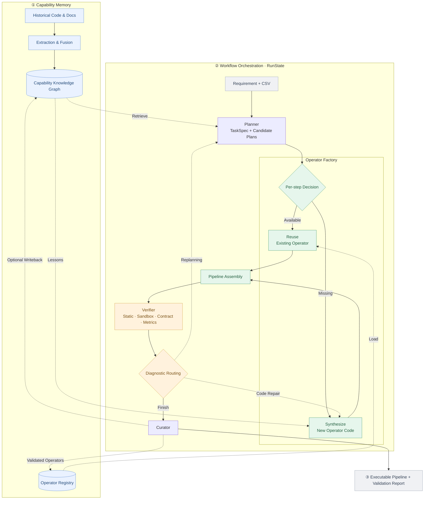
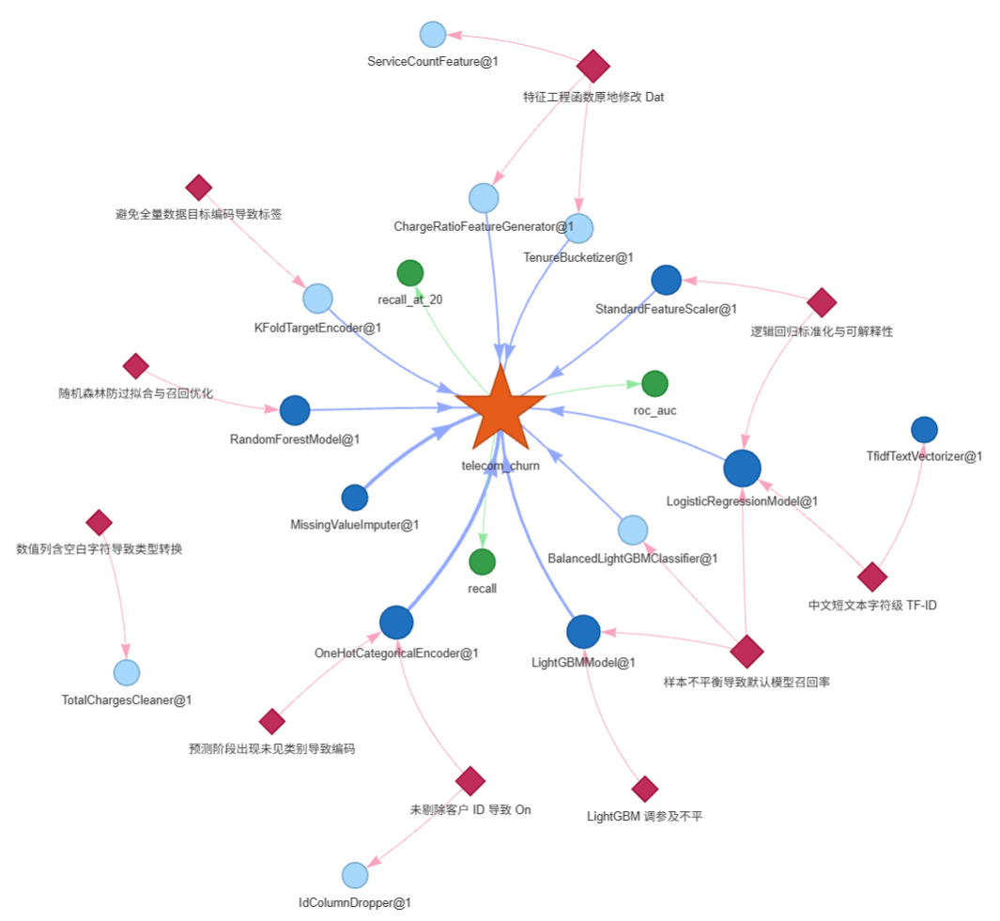
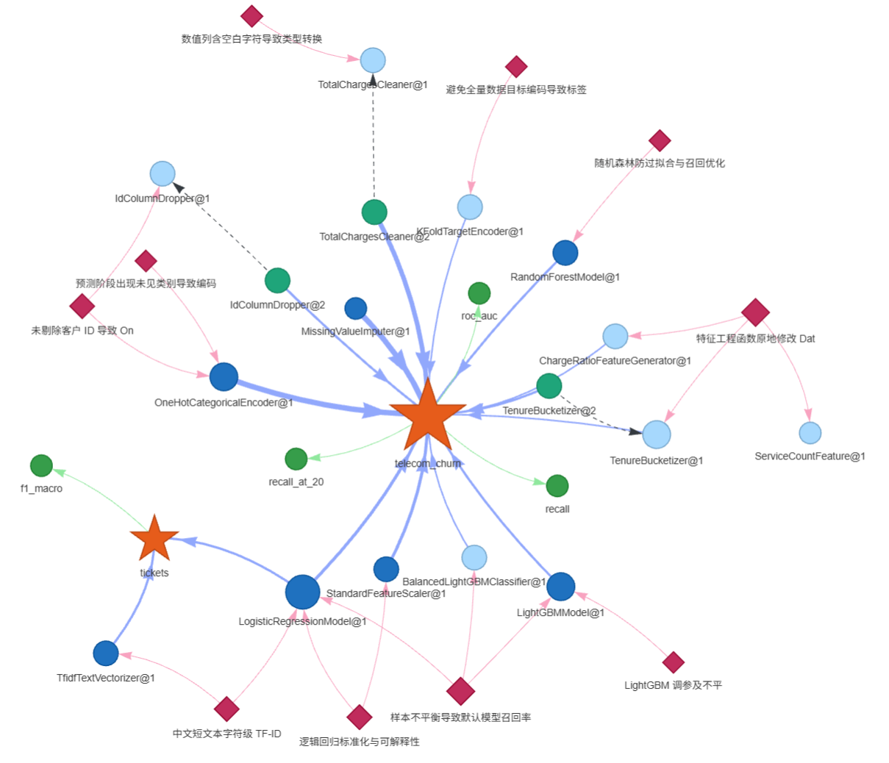
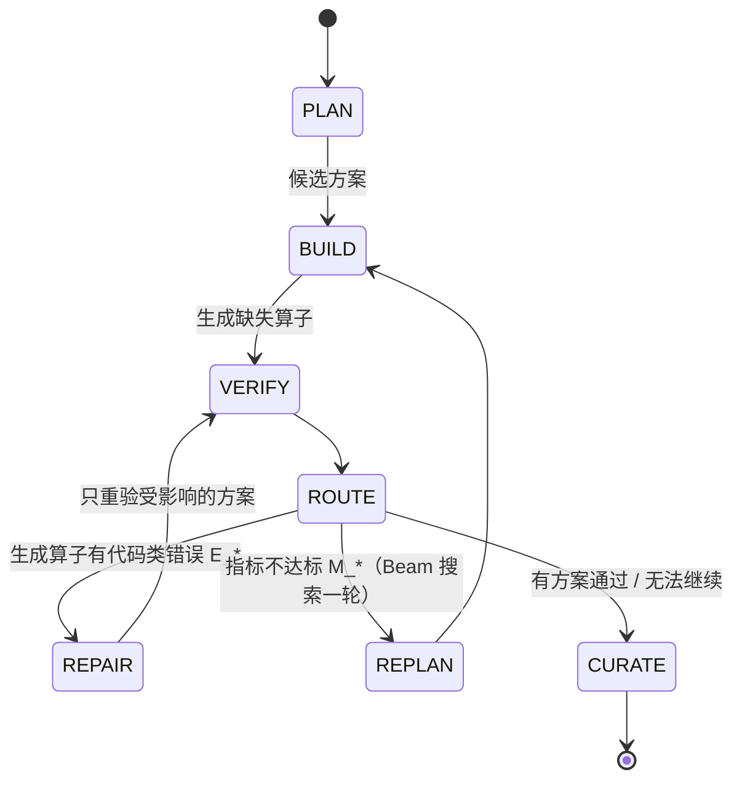

# AlgoForge：基于 AI Agent 的算法能力工厂

> 让 LLM 像一位能查阅公司历史项目的算法工程师那样工作：先查**以前做过什么、踩过什么坑**，再决定**哪些步骤可以复用、哪些需要新写**；写完交给**基于固定规则和实际执行结果的验证器**检查，能定位的代码问题交回修复；最后保存验证结果、可复用算子和修复经验，供后续任务检索。

```
能力抽取 ──▶ 能力复刻（Reuse / Synthesize）──▶ 自动验证 ──▶ 修复优化 ──▶ 知识沉淀
   ▲                                                                     │
   └──────────────────────── 下一次运行直接复用 ◀─────────────────────────┘
```

**快速开始（离线、无需 API Key）**

```bash
conda env create -f environment.yml && conda activate algoforge
python -m factory.cli demo          # 回放录制的真实 LLM 响应；安装完成后运行，耗时随机器配置变化
streamlit run app.py                # Web 界面
```

| 演示（`examples/demo/`） | 想证明什么 | 结果 |
| --- | --- | --- |
| [01 工单文本分类](examples/demo/runs/01_tickets_transfer/report.md) | **跨场景迁移**：图谱里没有这个场景的知识，靠通用经验（中文用字符级 TF-IDF）也能规划出可用方案 | F1-macro 0.828 ✅ |
| [02 客户流失](examples/demo/runs/02_churn_synthesize/report.md) | **知识驱动的生成**：参考历史代码生成 4 个新算子，3 个候选公平比较，最优方案通过后注册 `TotalChargesCleaner@2`、`TenureBucketizer@2` | recall 0.778 ✅ |
| [03 相似需求](examples/demo/runs/03_churn_reuse/report.md) | **沉淀后复用**：换一种说法提出相似需求，直接复用 02 沉淀的两个算子 | recall 0.778 ✅ |

任务 03 证明了算子可以被后续任务复用；当前没有对照实验验证持续运行是否提高指标、缩短耗时或降低 LLM 调用成本。

**文档导航**：[知识图谱：本体构建 → 知识抽取 → 知识融合 → 知识存储](docs/schema.md) ｜ [各 Agent 的输入与输出](docs/agents_io.md) ｜ [开发路线图](docs/roadmap.md)

### 题目要求与验收证据

对照 [ProjectTarget.md](ProjectTarget.md)，下表区分真实 LLM 录制回放、规则 mock 测试和当前实现边界：

| 题目要求 | 实现 | 可查看或复现的证据 |
| --- | --- | --- |
| 行业场景、示例材料与 LLM 接入 | 客户流失、工单分类；OpenAI 兼容接口及录制回放 | [数据说明](data/README.md)、[LLM 客户端](factory/llm.py)、[三任务演示](examples/demo/SUMMARY.md) |
| 能力抽取与知识图谱 | AST + LLM 抽取、规则融合、NetworkX 图谱 | [schema 与融合规则](docs/schema.md)、[原始抽取结果](kg/extraction.json)、[基础图谱](kg/capability_kg.json) |
| 自然语言到算法代码 | Planner 规划，Synthesizer 生成缺失算子 | 真实 LLM 录制回放：[任务 02 报告](examples/demo/runs/02_churn_synthesize/report.md)、[生成脚本](examples/demo/runs/02_churn_synthesize/pipeline.py) |
| 自动验证与多候选比较 | 四级验证、多种子交叉验证、候选排序 | [任务 02 候选结果](examples/demo/runs/02_churn_synthesize/report.md)、[验证测试](tests/test_verify.py)、[运行时安全测试](tests/test_sandbox_guard.py) |
| 多轮修复与经验提炼 | 有次数上限的定向修复、Curator 提炼 Lesson | [规则 mock 修复样例](examples/verification/README.md#定向修复与后续复用)；[闭环测试](tests/test_synthesis.py)验证一轮修复及后续复用，当前录制演示未触发修复 |
| 知识回写与能力版本复用 | 保存生成源码、验证记录和版本谱系 | [任务 02 注册 → 任务 03 复用](examples/demo/SUMMARY.md)、[沉淀的源码](examples/demo/kg/operators/) |
| Beam Search | 父方案扩展、去重、历史与本次观测先验剪枝 | [规则 mock 搜索样例](examples/verification/README.md#beam-search)、[先验与剪枝测试](tests/test_search.py)；尚无搜索收益的对照实验 |
| UI、报告与可扩展配置 | CLI、Streamlit、Markdown / HTML 报告、算子与指标注册接口 | [Web 入口](app.py)、[报告样例](examples/demo/runs/02_churn_synthesize/report.html)、[任务配置](configs/tasks/)；当前支持二分类和多分类 |

---

## 目录

1. [项目背景和目标：我怎么理解这道题](#1-项目背景和目标我怎么理解这道题)
2. [系统架构：像搭 PyTorch 模型一样组合算法能力](#2-系统架构像搭-pytorch-模型一样组合算法能力)
3. [能力知识图谱：四个关键步骤](#3-能力知识图谱四个关键步骤)
4. [Agent 工作流：四个角色，一个中央控制器](#4-agent-工作流四个角色一个中央控制器)
5. [环境配置和运行方法](#5-环境配置和运行方法)
6. [示例数据和测试任务说明](#6-示例数据和测试任务说明)
7. [生成算法代码示例](#7-生成算法代码示例)
8. [验证结果和报告样例](#8-验证结果和报告样例)
9. [遇到的挑战和解决方案](#9-遇到的挑战和解决方案)
10. [后续可扩展方向](#10-后续可扩展方向)

---

## 1. 项目背景和目标：我怎么理解这道题

### 题目真正要的是"闭环"，不是"一次代码生成"

让 LLM 根据一句需求写一段建模代码并不难。难的是在真实企业里，这样做有三个根本问题：

| 单次 prompt 生成代码的问题 | 后果 | 本项目的回答 |
| --- | --- | --- |
| **不知道企业已经有什么** | 重复造轮子；历史上踩过的坑（脏数据、数据泄漏、类别不平衡）再踩一遍 | **能力知识图谱**：把历史代码和文档中的经验抽取出来，规划和写代码之前先检索 |
| **不知道生成的代码对不对** | 能跑不等于正确：可能改了输入、产生 NaN、指标虚高、甚至读取密钥文件 | **四级验证器**：不调用 LLM，依据固定检查规则与执行结果判定；固定代码、数据、配置与环境后支持复现 |
| **做完就忘** | 下一次相似需求还要从头来 | **知识沉淀**：验证通过的算子注册进能力库，验证记录和修复经验写回图谱 |

所以我把题目中的七个环节组织成一个**可积累知识的闭环**：完成运行后按回写配置保存验证记录；最优且通过的方案中用到的新算子可以注册，原问题已解决的修复可以提炼经验。这些积累为后续任务提供检索依据，效果仍取决于知识质量与检索结果。

### 设计时反复问自己的三个问题

**① "算法能力"的粒度应该是什么？** —— 算子。

完整脚本通常需要额外拆分和适配才能部分复用。我参考 PyTorch 模块组合的思路，把能力拆成**算子（Operator）**：清洗、编码、特征、模型各是一个算子，带有自描述的元数据，并在接口与数据格式兼容时组合。于是：

- 知识图谱可以描述"这个算子适用于什么条件、依赖什么、历史表现如何"；
- 验证器在逐步执行和契约检查中可以定位部分错误；能定位到本次生成算子的代码问题才进入定向修复；
- 最优且通过的方案中使用的新算子可以**单独注册、供下次复用**。

**② LLM 应该做什么，不应该做什么？** —— 让 LLM 做判断，让代码提供事实、担任裁判。

| 交给 LLM（需要理解与创造） | 交给确定性代码（需要可靠与可复现） |
| --- | --- |
| 理解需求、规划方案、写算子代码、按诊断修复、从文档中抽取知识、把修复过程总结成经验 | 数据画像（列类型、缺失率、是否不平衡）、知识检索打分、方案的语义校验、四级验证、路由决策、版本管理 |

需求与方案输出分别校验为 `TaskSpec`、`PipelinePlan`，不合格时带错误重试。生成源码保存在 `GeneratedOperator` 中，源码本身通过静态检查与执行验证，满足路由条件时按诊断修复。

**③ 怎样让后续任务用上修复经验？** —— 让验证器和知识图谱说同一种语言。

验证器的每个诊断都有固定的**诊断码**（如 `E_NAN`、`E_RUNTIME`、`M_THRESHOLD`），知识图谱中的经验（Lesson）也用同一套诊断码标注。于是：

- 历史文档中"空白字符串转 float 报错"的复盘被抽取为 `E_RUNTIME` 经验；修复时先按诊断码过滤，再按报错文本相关度检索，取前几条放入 prompt；
- 一次修复成功后，Curator 把"诊断 → 修复"总结成新经验，用同一个诊断码写回；
- 诊断码参与**路由**：可定位且未超次数的生成代码错误优先交回 Synthesizer；没有通过的候选且允许重试时，再由 Planner 重新规划。

### 场景选择

- **电信客户流失预测**（表格二分类，主场景）：它集中了需要业务处理的情况——`total_charges` 是带空白的字符串、高基数的客户 ID、正负样本约 1:3、业务要求可解释且召回优先，用于观察历史知识如何进入规划和代码生成。
- **客服工单分类**（中文文本多分类）：图谱中没有这个场景的任何知识，用来检验同一套框架能否迁移。

## 2. 系统架构：像搭 PyTorch 模型一样组合算法能力

### 组合式设计

组合式设计参考了 PyTorch 的模块接口，以及 [DataFlow](https://github.com/OpenDCAI/DataFlow) 的 Operator / Pipeline 分层思路；本项目的执行层使用 sklearn Pipeline。

| PyTorch | 本项目 | 作用 |
| --- | --- | --- |
| `nn.Module` | `Operator`：sklearn 兼容（`fit/transform` 或 `fit/predict`）+ 元数据 `OperatorMeta` | 能力的最小单元，接口统一 |
| `nn.Sequential` | `sklearn.pipeline.Pipeline` | 把算子按顺序组合成完整方案 |
| `torchvision.models` 注册表 | `OperatorRegistry`（键为 `名称@版本`）+ 能力知识图谱 | 按名字和版本找到能力 |

算子通过 `meta` 声明描述、条件、依赖与参数，并实现 sklearn 接口；注册后可按名称与版本组合。接口定义和组装代码见 [算子接口与执行](docs/agents_io.md#算子接口与执行)。新增模板需要实现接口、注册类，并确保验证子进程能够导入它。

能力库持久化的是**算子实现源码**（`kg/operators/<Name>_v<版本>.py`）。Reuse 会在当前数据上重新拟合；训练后的模型由生成脚本另外保存为 `model.joblib`。

### 整体架构

**Workflow 是中央控制器**：统一调用各阶段，通过 `RunState` 保存需求、候选方案、源码和验证结果。下图分为能力记忆、工作流编排和输出三部分；实线连接主流程，虚线标注检索、加载、诊断反馈及回写关系。



一个候选方案可同时包含 Reuse 和 Synthesize 步骤；全部复用时无需调用 Synthesizer。Verifier 在验证子进程中加载所需实现并实例化流水线。Curator 负责运行后的知识回写；Planner 与 Synthesizer 读取图谱以规划或生成。

图中的 Pipeline Assembly 是逻辑步骤，实际组装与执行在 Verifier 的验证流程中完成；产物由 Workflow 导出。诊断路由是简化表示，定向修复的适用条件、指标失败后的 Beam Search 及停止条件，见[第 4 节的状态机](#4-agent-工作流四个角色一个中央控制器)。

```
├── factory/
│   ├── schemas.py          # 三层中间表示 TaskSpec / PipelinePlan / 代码，诊断码，共享状态 RunState
│   ├── operators/          # Operator 基类与注册表、7 个内置算子、生成算子的加载与持久化
│   ├── extract.py          # 能力抽取：AST + LLM → 知识图谱
│   ├── kg.py / kg_viz.py   # 知识图谱的本体、融合、存储、检索、可视化
│   ├── profile.py          # 数据画像：列角色与适用条件标签（确定性）
│   ├── agents/             # planner / synthesizer / curator；rules.py 为离线规则版
│   ├── verify/             # 四级验证：static / sandbox / checks，guard 为沙箱内的审计钩子
│   ├── workflow.py         # 中央控制器：显式状态机
│   ├── search.py           # 重新规划阶段的 Beam Search
│   ├── llm.py              # OpenAI 兼容客户端、结构化输出与重试、缓存、录制回放、MockLLM
│   ├── codegen.py          # 方案 → 可独立运行的 pipeline.py
│   ├── report.py           # Markdown / HTML 验证报告
│   └── demo.py / cli.py    # 演示与命令行
├── app.py                  # Streamlit 界面
├── configs/                # llm.yaml；tasks/*.yaml 为各任务类型的验证配置
├── data/                   # 示例数据与模拟业务材料
├── kg/                     # 知识图谱（JSON / GraphML / HTML）与原始抽取结果
├── examples/               # 录制的 LLM 响应（cassettes）与演示产物
├── docs/                   # schema.md、agents_io.md、roadmap.md
└── tests/                  # 118 个常规测试 + 1 个完整演示回放测试
```

### 技术选型

| 选择 | 理由 |
| --- | --- |
| 自研状态机（约 360 行），不用 LangGraph / AutoGen | 状态转移一目了然，每个转移都能单独测试；依赖少，复现简单 |
| NetworkX + JSON / GraphML，不用 Neo4j | 原型规模（百级节点）无需部署数据库，图谱文件可以进 Git、做 diff；GraphML 便于交换，迁移到 Neo4j 还需导入工具与属性映射 |
| BM25+（rank-bm25） | 轻量、可解释、不需要向量模型；中文按字 + 二元组切分 |
| pydantic | 校验需求、方案、抽取结果等 JSON 输出；生成源码另外交给验证器检查 |
| sklearn 接口的算子 | 直接复用 Pipeline、clone、交叉验证生态 |
| OpenAI 兼容接口 + 录制回放 | 可配置兼容的模型与接口；已录制的示例无需 API Key 即可回放 |
| Streamlit + pyvis | 少量代码即可得到可交互的界面与图谱 |

## 3. 能力知识图谱：四个关键步骤

知识图谱为系统保存可检索的长期知识。我从 Agent 的需要反推节点与关系：既记录选型所需的条件和历史表现，也记录来源与版本谱系。构建过程分为四步，完整说明及关系图见 [docs/schema.md](docs/schema.md)。

| 步骤 | 要解决的问题 | 做法 |
| --- | --- | --- |
| **① 本体构建** | 一个"算法能力"该用哪些概念描述？ | 8 类节点（场景、算子、指标、适用条件、依赖、验证记录、经验、出处）、9 类边；区分可执行的"能力"与只能参考的"知识"；阈值放在"场景 → 指标"的边上；经验与验证器共用诊断码；适用条件使用受控词表 |
| **② 知识抽取** | 怎样从代码和文档里把知识拿出来？ | 代码：AST 解析签名、依赖与源码（确定性），LLM 归纳为能力卡片；文档：LLM 抽取指标阈值、约束、历史实验和经验；运行时：Curator 从修复过程中提炼经验 |
| **③ 知识融合** | 多个来源说的是不是同一件事？冲突时信谁？ | 实体链接到已有节点；`RecallAtTopK(k=0.2)` / `recall@20%` / `recall_at_20` 规范化为同一指标；诊断码相同且标题相似的经验合并（11 → 10 条）；场景阈值只以需求文档为准；被推翻的实验保留但不计入历史分；生成算子接入已有版本谱系 |
| **④ 知识存储** | 存成什么样，Agent 怎么用？ | NetworkX 图 + JSON 主存储 + GraphML 交换格式 + HTML 可视化；检索打分 `0.4 × BM25+ 文本 + 0.3 × 条件匹配 + 0.3 × 历史验证分`，每条结果带分项得分和证据；每次运行结束回写 |

**图谱中最有价值的两类知识**，都来自历史材料而不是通用常识：

```json
{"type": "Lesson", "title": "数值列含空白字符导致类型转换失败", "error_code": "E_RUNTIME",
 "trigger": "新入网客户累计消费为空白字符串，转 float 时抛出 ValueError: could not convert string to float: ' '",
 "fix": "先 str.strip()，再 pd.to_numeric(errors='coerce')，缺失值填补为 0"}
{"type": "ValidationRun", "metrics": {"roc_auc": 0.97}, "passed": false, "origin": "history",
 "note": "作废：全量数据目标编码泄漏标签，上线后 AUC 跌至 0.71"}
```

前者让 Planner 知道要先清洗 `total_charges`、让 Synthesizer 知道怎么写；后者让系统知道**AUC 0.97 的方案不可信**，不会因为它"历史分高"就推荐。

| 文件 | 内容 |
| --- | --- |
| [`kg/capability_kg.json`](kg/capability_kg.json) / `.graphml` / [概览 `.html`](kg/capability_kg.html) / [完整 `_full.html`](kg/capability_kg_full.html) | 基础知识图谱：14 个算子（7 个内置 + 7 个抽取）、10 条经验、5 条历史实验 |
| [`kg/extraction.json`](kg/extraction.json) | 融合前的 LLM 原始抽取结果 |
| [`examples/demo/kg/`](examples/demo/kg/) | 演示 3 个任务后的图谱：算子 14 → 17、验证记录 5 → 12、场景 1 → 2；`operators/` 下是沉淀的生成算子源码 |

可视化：`python -m factory.cli kg viz` 同时生成**概览**（只画场景 / 指标 / 算子 / 经验四类主干节点，演示后为 33 个节点 / 39 条边）与**完整视图**（81 / 174）；`--focus <节点 id>` 只看某个节点的邻域。Web 界面中可以切换。

下面并排展示**初始图谱**与**三个演示任务完成后的图谱概览**，点击图片可查看原图。

<table>
  <tr>
    <th width="50%">初始图谱</th>
    <th width="50%">演示后的图谱概览</th>
  </tr>
  <tr>
    <td width="50%" align="center" valign="top">
      <a href="pic/初始图谱.png"></a>
    </td>
    <td width="50%" align="center" valign="top">
      <a href="pic/演示后的图谱概览.png"></a>
    </td>
  </tr>
</table>

右图新增了 `tickets` 场景，以及 `TotalChargesCleaner@2`、`TenureBucketizer@2`、`IdColumnDropper@2` 三个生成并注册的算子；虚线连接新旧版本，展示能力沉淀后的版本谱系。

## 4. Agent 工作流：四个角色，一个中央控制器

### 为什么是四个角色

我按照"一个算法工程师团队"来分工，而不是让一个 prompt 包办一切。每个角色只看完成本职所需的信息，输出都是结构化对象，因此可以分别测试、分别替换，出了问题也能定位到是哪个角色。

| 角色 | 职责 | 用 LLM | 关键输出 |
| --- | --- | :-: | --- |
| **Planner** | 需求 + 数据画像 → `TaskSpec`；按步骤检索知识图谱；给出 N 个候选 `PipelinePlan`，每步说明 Reuse 还是 Synthesize 及理由 | ✅ | `TaskSpec`、`PipelinePlan` |
| **Synthesizer** | 为 synthesize 步骤按规格生成源码，有历史实现时参考它；修复可定位的本次生成算子，并带上检索到的同诊断码经验。reuse 步骤由执行层实例化 | ✅ | `GeneratedOperator` |
| **Verifier** | 四级验证，输出带诊断码的 `Diagnostic`，能定位时附上算子名 | — | `ValidationReport` |
| **Curator** | 注册最优方案中验证通过的新算子；把所有候选的验证结果（含失败的）写回图谱；把成功的修复提炼为经验 | 仅提炼经验 | 图谱中的新节点与边 |

**为什么 Verifier 不调用 LLM**：以程序化规则和实际执行结果判定，便于追查诊断依据，也避免以模型的自然语言评价作为验收结论。固定代码、数据、配置、随机种子与依赖环境后支持复现；资源限制、平台差异仍可能影响运行结果。验证通过表示满足当前检查项，不代表覆盖所有业务正确性和安全风险。

各 Agent 的输入字段、输出 schema、校验方式和真实样例，见 **[docs/agents_io.md](docs/agents_io.md)**。

### 中央控制器：显式状态机

Agent 之间不直接互相调用，全部由 `factory/workflow.py` 调度，通过共享状态 `RunState`（黑板）交换数据：



### 几个我认为重要的设计

1. **分层的结构化中间表示**（借鉴编译器）：`TaskSpec`（做什么）→ `PipelinePlan`（怎么做）→ 源码。前两层做 schema 和部分语义检查，源码再接受静态与执行验证，尽量提前发现问题。
2. **知识驱动的能力组合**：Planner 收到带分项得分和证据的检索结果，报告展示这些依据与生成理由；目前未逐条核验理由是否与证据一致。
3. **诊断驱动的定向修复**：能定位到本次生成算子、且未超次数的代码错误才进入修复。LLM 返回该算子的完整源码，随后重新验证受影响的完整方案；不保证最小代码 diff。先处理可修复候选，再选优。
4. **知识图谱先验引导的 Beam Search**（`factory/search.py`）：需要重新规划时，以排名前 k 的已验证方案为父方案，请求扩展 k × m 个子方案；按步骤、算子和参数签名去重，以场景历史记录和本次观测计算先验，最多保留 k 个验证。它限制的是每轮候选数量；新增的规划调用、不同模型与修复次数仍会影响耗时。当前先验是启发式估计，尚未证明优于无搜索基线。

### 四级验证

| 级别 | 检查什么 | 诊断码 |
| --- | --- | --- |
| 1 静态检查 | 语法；import 白名单；禁止 `eval/exec/open/getattr/__dunder__` 等调用；禁止库自带的文件读写、下载与字符串求值入口（`pd.read_*`、`df.to_*`、`np.load`、`df.query` 等）；接口齐全；`meta.params` 与 `__init__` 默认值一致 | `E_SYNTAX` `E_UNSAFE` `E_INTERFACE` |
| 2 沙箱执行 | 独立子进程，限制超时与内存，清除含 KEY/TOKEN/SECRET 的环境变量；子进程内装审计钩子（PEP 578），按行为拦截越权的文件、网络、子进程与动态库操作；小样本冒烟并定位出错算子 | `E_UNSAFE` `E_RUNTIME` `E_TIMEOUT` |
| 3 契约检查 | 不修改输入；行数一致；不新引入 NaN/Inf；`predict_proba` 为合法概率的 ndarray；能处理未见类别与缺失值 | `E_MUTATION` `E_SHAPE` `E_NAN` `E_PROBA` |
| 4 指标检查 | 多种子 × 分层 K 折交叉验证；阈值；种子间稳定性；指标过高疑似泄漏；耗时与内存 | `M_THRESHOLD` `M_UNSTABLE` |

当前支持二分类和多分类，验证配置从 `configs/tasks/<task_type>.yaml` 读取，可据此调整已有任务的验证参数。指标通过 `@metric("name")` 注册，并需在验证子进程中导入；新增回归、时序等任务还需扩展任务 schema、模型接口、数据切分、指标及验证流程。

使用时还需核对业务正类与指标是否受支持；当前验证在指标缺失、约束验收等方面的边界见 [Verifier 说明](docs/agents_io.md#当前验证范围)。

## 5. 环境配置和运行方法

以下命令都在**仓库根目录**执行。第一次体验建议先跑离线 `demo`；要处理自己的需求，再配置 API 并选择 `live`。

### 5.1 准备环境

```bash
# 首次使用：创建环境，同时安装依赖与本项目
conda env create -f environment.yml

# 每次打开新终端后激活；环境已存在时，直接从这一步开始
conda activate algoforge
```

环境使用 Python 3.11。激活后可用 `which python`（Linux/macOS）或 `where python`（Windows）检查解释器路径是否位于 `algoforge` 环境中。

### 5.2 先选模式：LLM 的回答从哪里来

通过 `--llm <模式>` 显式选择回答来源。**这控制的是 LLM 调用方式，不决定流水线是否包含新算子。**

| 模式 | 回答来源 | 是否请求远端 API | 适用情况 |
| --- | --- | --- | --- |
| `replay` | 读取 `examples/cassettes/` 中匹配的已录制响应 | 否，不需要 API Key；缺少录制时直接报错 | 复现已有示例 |
| `live` | 先读 `.cache/llm/`，未命中时请求 API 并缓存 | 未命中时请求；使用该模式需配置 API Key | 运行自己的新需求 |
| `record` | 先读 `examples/cassettes/`，未命中时请求 API 并录制 | 未命中时请求；使用该模式需配置 API Key | 为新任务准备离线回放 |
| `mock` | 本地规则提供需求理解、规划、源码和修复响应 | 否，不需要 API Key | 测试规则支持的场景和错误分支 |

**不同入口的默认值不同**：`demo`、`extract` 默认 `replay`；`run` 默认 `live`；Web 界面默认选中 `live`。下面的示例显式写出模式，避免混淆。

### 5.3 只看现有项目效果：离线演示

```bash
python -m factory.cli demo --llm replay
```

命令依次运行工单分类、客户流失预测和相似需求复用，结果写入 `runs/demo/`，知识图谱在该目录下的副本中更新。运行耗时随机器配置变化。

回放时，需求理解、方案和生成源码取自以前保存的 LLM 响应；**流水线组装、训练、验证和指标计算仍实际执行**，并重新生成 `pipeline.py`、`state.json`、`report.md` 与 `report.html`。因此，离线运行也会产生代码文件，但本次没有请求远端 LLM 新写源码。

`demo` 默认使用仓库中的基础图谱与录制请求。若修改基础图谱、模型配置或其他影响 prompt 的内容，现有录制可能不再匹配。

### 5.4 处理自己的需求：在线运行

先准备 API 配置：如果没有 `.env`，复制 `.env.example` 为 `.env`，填入自己的 `LLM_API_KEY`；已有 `.env` 时直接编辑，保留现有配置。

**API 平台**：本项目开发及录制示例使用 [XHub API 平台](https://api15.xhub.chat)，通过 OpenAI 兼容客户端调用。[默认配置](configs/llm.yaml) 为：

```dotenv
LLM_BASE_URL=https://api15.xhub.chat/v1
LLM_MODEL=gemini-3.5-flash
```

这两个变量可按需写入 `.env` 覆盖配置；更换模型或接口后需验证兼容性。`LLM_API_KEY` 从环境变量读取，也支持由 `.env` 加载。

```bash
# 请求远端接口检查连通性并列出模型，不执行建模任务
python -m factory.cli llm-ping

# 处理需求；首次试用不持久修改基础知识图谱
python -m factory.cli run "预测30天内可能流失的客户，需可解释，召回优先" \
  --data data/churn.csv --llm live --no-writeback
```

这次运行会获取 Planner 的需求理解与方案：

- 步骤为 **Reuse**：从注册表实例化已有算子，在当前数据上拟合；不需要为这一步编写源码。
- 步骤为 **Synthesize**：获取 Synthesizer 的源码响应；缓存未命中时才请求远端 LLM 编写。
- 出现可修复的生成代码错误：按诊断获取修复响应，再验证。

所以，**`live` 不保证每次都请求 API，也不保证每次都有新算子**。`--no-synthesis` 只禁止生成新算子，需求理解和规划仍使用所选 LLM 模式，并不等于离线运行。

结果默认写到 `runs/<run_id>/`。`run` 默认把验证结果与符合条件的新算子写回 `kg/capability_kg.json` 及同目录的 `operators/`；加 `--no-writeback` 保留运行报告和脚本，但不持久修改基础能力库。

### 5.5 保存新任务，之后离线复现：先录制，再回放

```bash
# 首次录制：匹配不到已有响应的请求会调用 API，并保存到 examples/cassettes/
python -m factory.cli run "预测30天内可能流失的客户，需可解释，召回优先" \
  --data data/churn.csv --candidates 1 --llm record --no-writeback

# 保持需求、数据、模型配置、知识图谱和其他参数一致，再切换为 replay
python -m factory.cli run "预测30天内可能流失的客户，需可解释，召回优先" \
  --data data/churn.csv --candidates 1 --llm replay --no-writeback
```

两条命令都使用 `--no-writeback`，避免第一轮回写知识图谱改变第二轮的检索上下文。`record` 发现已有匹配响应时也会直接读取，并不强制刷新。

回放按**模型、消息内容与 JSON 输出模式**匹配录制响应，文件名还带调用标签。修改需求、数据画像、候选数、知识图谱或提示词，都可能产生新的请求。若出现 `no recorded response`，说明没有对应录制，**不会自动转为在线调用**；要么恢复原上下文，要么配置 API 后用 `record` 补充该请求。

`live` 的缓存与 `record` 的录制使用不同目录：只运行过 `live`，不代表该任务已经可以用 `replay` 复现。

### 5.6 Web 界面与其他命令

```bash
streamlit run app.py
```

启动页面本身不会执行 LLM 建模任务。在“运行”页选择模式并点击“开始”才启动工作流；默认选中 `live`。已有录制只适用于匹配的上下文，不保证 Web 中的任意输入都可回放；复现三个固定任务时优先使用 `demo --llm replay`。Web 默认在图谱副本上运行，勾选“回写知识图谱”后才持久修改所选图谱。

| 命令 | 说明 |
| --- | --- |
| `python -m factory.cli extract --llm replay` | 读取已有录制抽取响应，从 `data/materials/` 重建图谱；默认覆盖 `kg/`，可用 `--out <路径>` 指定输出 |
| `python -m factory.cli extract --llm record` | 对新材料获取抽取响应并录制，未命中时调用 API；需配置 Key |
| `python -m factory.cli kg stats / search / lessons / tidy / viz` | 查看、检索、整理图谱或生成可视化，不调用 LLM；其中 `tidy` 会保存整理结果 |
| `python -m factory.cli report runs/<run_id>` | 从已保存状态重新生成报告，不调用 LLM |
| `python -m factory.cli operators` | 列出当前注册表中的算子，不调用 LLM |
| `pytest` / `pytest -m slow` | 118 个常规测试 / 1 个完整演示回放测试，不需要远端 LLM |

`run` 还支持 `--target <目标列>`、`--candidates 3`、`--max-repairs 3`、`--max-replans 2`、`--beam-width 2 --beam-expand 3` 和 `--kg <路径>`；完整参数见 `python -m factory.cli run --help`。

SDK 报错会脱敏，请求缓存键不含密钥；沙箱会清除名称含 KEY / TOKEN / SECRET 等的环境变量。`tests/test_secrets.py` 扫描待跟踪文件中的已配置密钥和常见密钥格式。

**平台支持**：代码包含 Windows 的 psutil 内存看门狗分支，Linux/macOS 使用 `RLIMIT_AS` 资源限制；当前记录的运行结果来自 Linux，其他平台需在对应环境验证。上面的多行命令采用 Bash 续行写法，其他终端可合并为一行执行。

## 6. 示例数据和测试任务说明

数据与材料都由脚本生成、随机种子固定（详见 [data/README.md](data/README.md)）。我有意在数据里保留了真实业务中常见的"坑"，让历史经验真正派得上用场：

| 数据 / 材料 | 说明 |
| --- | --- |
| `data/churn.csv` | 5000 行电信客户数据，流失率 26.6%；`total_charges` 是字符串且新客户为空白、部分列缺失、高基数 `customer_id` |
| `data/tickets.csv` | 2000 条中文客服工单，4 类、不均衡，含跨类表述与约 6% 标签噪声 |
| `data/materials/legacy_repo/` | 模拟的历史代码仓库 `churn_v1`：清洗、特征、目标编码、LightGBM、阈值调整、recall@k 等 9 个函数 |
| `data/materials/docs/` | 需求说明、实验记录、失败复盘、调参经验 4 篇文档 |

| 测试任务 | 需求 | 考察点 |
| --- | --- | --- |
| 客户流失 | "预测30天内可能流失的客户，需可解释，召回优先" | 阈值来自图谱中的需求文档（recall ≥ 0.75）；脏数据需要生成清洗算子；可解释约束偏向线性模型 |
| 客户流失（相似需求） | "预测下个月可能流失的客户，要能解释原因，尽量不漏掉流失客户" | 复用上一次沉淀的算子 |
| 工单分类 | "把客服工单自动分到四类，宏平均 F1 不低于 0.8" | 跨场景迁移：新场景无场景知识，依靠通用经验 |

## 7. 生成算法代码示例

工作流有可导出的候选方案时，会生成 `pipeline.py`，在已安装本项目及依赖的环境中可独立调用：内置算子以 import 引用，生成的算子源码内嵌，每一步附上 Planner 的理由。完整代码见 [03 相似需求脚本](examples/demo/runs/03_churn_reuse/pipeline.py)。以下仅节选复用步骤：

```python
# 从完整 Pipeline 的步骤中节选；前后步骤见链接中的脚本。
("1_imputer", TotalChargesCleaner(col='total_charges', fill_value=0.0)),
("2_imputer", MissingValueImputer()),
```

`TotalChargesCleaner@2`、`TenureBucketizer@2` 是任务 02 中由 LLM 参考历史代码生成、验证通过后注册的算子（源码在 [`examples/demo/kg/operators/`](examples/demo/kg/operators/)），任务 03 直接复用。报告保留了检索经验和 Planner 理由，供人工核对。

```bash
python examples/demo/runs/03_churn_reuse/pipeline.py --data data/churn.csv            # 训练并保存 model.joblib
python examples/demo/runs/03_churn_reuse/pipeline.py --predict data/churn.csv          # 预测
```

**修复与搜索示例**：当前三个录制演示没有触发修复或重新规划。另附[规则 mock 的运行节选](examples/verification/README.md)，展示生成 → `E_NAN` → 修复 → 验证通过 → 注册 → 再次复用，以及指标失败后的 Beam 扩展与剪枝。样例经过真实验证器执行，但规划、代码和经验文本由规则提供，不能据此评估真实 LLM 的修复成功率或搜索收益。

## 8. 验证结果和报告样例

每次运行在运行目录生成 `report.md` 与 `report.html`（同一份内容的两种渲染）：需求理解、知识检索的分项得分与证据、候选比较（均值 ± 种子间标准差、指标条形图）、最优方案每一步的理由、生成算子与修复 diff、方案搜索记录、四级验证配置与资源消耗、知识沉淀、生成的代码与运行记录。

样例：[任务 02 报告](examples/demo/runs/02_churn_synthesize/report.md)（[HTML](examples/demo/runs/02_churn_synthesize/report.html)），节选：

| 排名 | 方案 | 结果 | recall | roc_auc | 单次训练 (s) |
| --- | --- | --- | --- | --- | --- |
| 1 | ★ interpretable_logistic_regression | 通过 | 0.778 ± 0.001 | 0.814 ± 0.001 | 0.088 |
| 2 | cost_ratio_random_forest | 未通过（`M_THRESHOLD`） | 0.714 ± 0.003 | 0.804 ± 0.001 | 0.612 |
| 3 | balanced_lightgbm_boosting | 未通过（`M_THRESHOLD`） | 0.630 ± 0.003 | 0.783 ± 0.004 | 0.259 |

在"可解释 + 召回优先 + 不平衡"的约束下，按图谱经验做了标准化、并设置 `class_weight='balanced'` 的逻辑回归是唯一达标的方案，两个树模型的 recall 都没到 0.75。

全部演示结果见 [examples/demo/SUMMARY.md](examples/demo/SUMMARY.md)。测试覆盖：schema 校验、算子契约、验证器对各类坏代码给出正确诊断码（静态安全违规、运行时越权读写文件 / 联网 / 起进程、崩溃、修改输入、行数错误、NaN、超时、指标不达标、泄漏）、知识图谱读写、融合与检索、Planner 的语义校验与重试、Beam 搜索的去重 / 先验 / 剪枝、生成 → 修复 → 注册 → 复用全流程、报告渲染与 HTML 转义、Web 界面、离线回放与录制结果一致。

## 9. 遇到的挑战和解决方案

| 挑战 | 我的思考 | 解决方案 |
| --- | --- | --- |
| LLM 输出不稳定：引用不存在的算子、乱起参数名、在只允许复用时生成 | 不能指望 prompt 写得足够好，要让错误在结构上无处藏身 | 每层输出用 pydantic 校验 + 语义检查，错误信息回传 LLM 重写；真实录制中可见一次被拒后改正 |
| LLM 编造指标阈值（给只需"报告"的 recall@20% 设 0.7，导致所有方案失败） | 门槛决定成败，必须有出处 | 次要指标的阈值必须能在需求原文或图谱中找到，否则只报告不设门槛 |
| 生成代码的隐蔽缺陷：`predict_proba` 返回 DataFrame、`meta.params` 与 `__init__` 不一致、转换后留下 NaN | "能跑"不等于"正确"，这些都是开发中真实遇到的 | 加入契约 / 静态检查，定位到具体算子；诊断附带修复提示 |
| 执行 LLM 生成的代码有安全风险；只按名字拦截不够（`pd.read_csv('.env')` 能绕过 `open()` 黑名单） | 按写法拦截总有漏网之鱼，要按行为拦截 | 三道防线：静态检查 → 子进程内的审计钩子（按行为拦截越权文件、网络与进程操作）→ 进程级隔离（超时、内存、清除密钥、临时目录）；注册前再做一次静态复查；Web 界面以 `data:` URL 隔离展示 LLM 生成的内容 |
| 重新规划时 LLM 容易给出重复或盲目的新方案 | 历史验证记录可作为候选筛选依据 | Beam 搜索：以排名靠前的方案为父方案，请求局部修改，按签名去重、按启发式先验剪枝，每轮最多验证 k 个；实际耗时和效果需另做对照实验 |
| 多来源抽取带来重复和冲突的知识 | 图谱越大越乱，会反过来误导检索 | 知识融合：指标名规范化、经验按"诊断码 + 标题相似度"合并、场景阈值只信需求文档、被推翻的实验不计分；`kg tidy` 可整理已有图谱 |
| 评审复现依赖 LLM 与 API Key | 结果必须能被别人重现 | 录制回放：请求哈希不含密钥与地址；`demo --llm replay` 离线复现，测试校验回放结果与仓库一致 |
| 合成数据太容易，F1 = 1.0 被泄漏检测判为异常 | 数据要有真实难度，验证才有意义 | 工单数据加入跨类表述与标签噪声 |
| 64 核服务器上 LightGBM / OpenMP 线程与内存上限冲突 | 沙箱限制不能误伤正常代码 | 沙箱中限制线程数与 malloc arena |

## 10. 后续可扩展方向

- **方案搜索**：先验目前只基于逐算子的历史统计；可以学习算子组合的交互效应，或改为 MCTS 并用验证结果回传更新先验
- **更强的隔离**：审计钩子是进程内防线（C 扩展的底层调用不经过它），生产环境应再加容器或 gVisor 与网络命名空间隔离
- **更多任务类型**：回归、时序预测、异常检测需扩展任务 schema、模型接口、数据切分与验证流程，再增加任务配置、指标和算子；图像缺陷识别还需要新的数据模态
- **真实代码仓库抽取**：支持类、跨文件调用关系、git 历史与测试用例；接入 Neo4j 承载更大规模图谱
- **人机协同**：在界面中审阅、编辑 Planner 的方案和生成代码后再验证；经验的人工审核与淘汰
- **部署**：从 `pipeline.py` 自动生成 FastAPI 服务、Dockerfile 与接口文档

开发过程与各里程碑的实际结果见 [docs/roadmap.md](docs/roadmap.md)。
