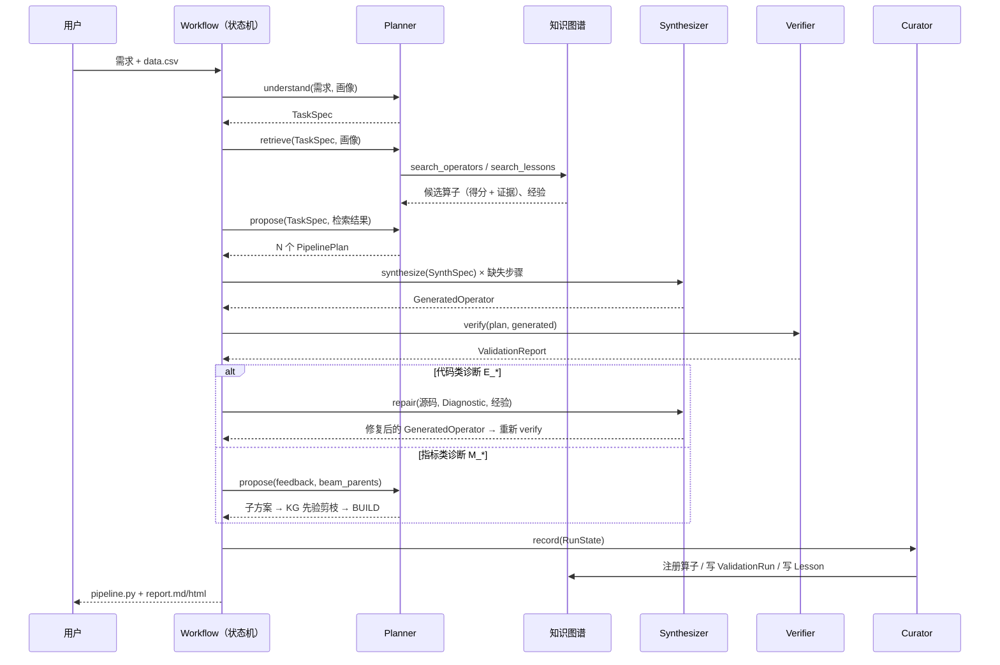

# Agent 的输入与输出（Query / Response）

本文档逐个说明每个 Agent **收到什么、返回什么、返回后怎样被校验**。需求、方案与验证结果等通过结构化对象交换；模型主要定义在 `factory/schemas.py`，部分定义在 `planner.py`、`profile.py` 和 `extract.py`。生成源码是字符串，由 Verifier 检查其内容与执行行为。

文中的 JSON 与代码片段经过节选，用于说明字段与接口，不一定是完整可运行输入。可复现的真实 LLM 录制见 [`examples/cassettes/`](../examples/cassettes/)，完整演示结果见 [`examples/demo/`](../examples/demo/)；修复与搜索的规则 mock 运行节选另见 [`examples/verification/`](../examples/verification/)。

## 总览

| 阶段 | 调用 | LLM | Query（输入） | Response（输出） | 校验 / 失败时 |
| --- | --- | :-: | --- | --- | --- |
| 需求理解 | `Planner.understand` | ✅ | 自然语言需求 + 数据画像 + 场景指标 | `TaskSpec` | schema + 目标列存在；无出处的次要阈值被移除 |
| 知识检索 | `Planner.retrieve` | — | `TaskSpec` + 画像标签 | `PlanningContext`（每类步骤的候选算子 + 经验） | 确定性 |
| 方案规划 | `Planner.propose` | ✅ | `TaskSpec` + 画像 + 检索结果（+ 反馈 / 父方案） | `PlanSet`（N 个 `PipelinePlan`） | schema + 语义检查，不通过带错误重问 |
| 代码生成 | `Synthesizer.synthesize` | ✅ | `SynthSpec` + 任务摘要 + 参考代码 + 经验 | `GeneratedOperator`（源码） | 交给 Verifier |
| 代码修复 | `Synthesizer.repair` | ✅ | 上一版源码 + `Diagnostic` + 同诊断码经验 | `GeneratedOperator`（修订号 +1） | 交给 Verifier |
| 自动验证 | `Verifier.verify` | — | `PipelinePlan` + `TaskSpec` + 数据 + 生成源码 | `ValidationReport`（指标 + `Diagnostic` 列表） | 确定性 |
| 知识沉淀 | `Curator.record` | 部分 | `RunState` | 写入 KG：算子、`ValidationRun`、`Lesson` | 注册前再做一次静态复查 |
| 经验提炼 | `Curator.distill` | ✅ | `RepairRecord`（诊断 + 代码 diff） | `LessonRecord` | schema |



---

## 0. 通用约定

### 消息结构

Planner 和 Curator 的首次结构化请求通常使用以下三条消息；校验失败后会追加原回复与错误反馈：

```
system : 角色 + 规则（例如"你是算法能力工厂的 Planner……规则：……"）
user   : <<CONTEXT>> {结构化输入 JSON} <</CONTEXT>>
system : Respond with a single JSON object only, ... conforming to this JSON schema: {pydantic 生成的 JSON Schema}
```

- **工作流上下文使用 JSON 字段**：Planner、Synthesizer 和 Curator 通过 `<<CONTEXT>>` 接收画像、检索结果与诊断。规则 mock 解析相同的上下文格式，走相同的工作流与验证器；响应由规则提供，不能替代真实 LLM 能力评估。离线抽取的请求还包含直接拼接的代码或文档文本；
- **输出要求符合 schema**：`LLM.structured()` 把 pydantic 模型的 JSON Schema 放进 prompt，返回后先做 schema 校验，再执行调用方提供的语义检查 `check`；
- **失败带错误重问**：任一校验失败，把原回复和错误信息追加进对话（`Your JSON was invalid: ...`），最多重试 `attempts` 次；
- **代码生成例外**：Synthesizer 使用角色规则和上下文两条消息，要求返回一个 ```` ```python ```` 代码块，不走 `LLM.structured()` 的 JSON 校验。

### 算子接口与执行

算子通过 `meta` 描述名称、类型、适用条件和依赖。以下是接口示意，`fit` / `transform` 的省略号需要由具体实现替换；完整实现见 [tabular.py](../factory/operators/tabular.py)。

```python
@register
class MissingValueImputer(TransformerMixin, Operator):
    meta = OperatorMeta(
        name="MissingValueImputer",
        kind=OperatorKind.IMPUTER,
        description="数值列用中位数、类别列用众数填补缺失值。",
        conditions=["has_missing_values"],
        dependencies=["pandas"],
    )

    def fit(self, X, y=None): ...
    def transform(self, X): ...
```

内置算子在导入时注册；生成算子先在验证子进程中加载，最优且通过的方案所用新算子再由 Curator 持久化并在主进程注册。执行层按步骤实例化算子，核心逻辑为：

```python
steps = []
for i, step in enumerate(plan.steps):
    ref = step.operator_ref or step.synth_spec.name
    steps.append((f"{i}_{step.kind.value}", registry.create(ref, **step.params)))
pipe = Pipeline(steps)
```

完整实现见 [operators/__init__.py](../factory/operators/__init__.py)。只有输入输出与步骤顺序兼容的算子才能组合。Reuse 复用实现和参数配置，仍在当前训练数据上拟合；生成源码与训练后的模型权重分别保存。

### 调用标签

每次调用带一个 `tag`（`plan_spec`、`plan`、`synthesize`、`repair`、`lesson`、`extract_code`、`extract_doc`），用于缓存与录制回放的文件名（`<tag>-<请求哈希>.json`，哈希不含密钥与地址）。

### 共享状态 RunState

Agent 之间不直接调用，而是由 `factory/workflow.py` 调度，通过共享状态 `RunState` 交换数据：

| 字段 | 写入方 | 读取方 |
| --- | --- | --- |
| `request` `data_path` `target` | 用户 | Planner |
| `spec`（TaskSpec） `profile_tags` `retrieval` | Planner | 全部 |
| `candidates`（PipelinePlan 列表） | Planner | Synthesizer、Verifier、Curator |
| `generated`（算子名 → GeneratedOperator） | Synthesizer | Verifier、Curator |
| `reports`（ValidationReport 列表） `history` | Verifier | Workflow 路由、Curator |
| `repairs`（RepairRecord 列表） | Workflow（修复时） | Curator |
| `search`（SearchRound 列表） | Workflow（Beam 搜索） | 报告 |
| `best_plan` | Workflow（`rank_reports`） | Curator、导出代码 |
| `registered` `kg_writes` `lessons_learned` `lessons_used` | Curator / Workflow | 报告 |

每次运行结束，`RunState` 完整保存为 `runs/<run_id>/state.json`，报告可由它重新生成。

---

## 1. Planner Agent

### 1.1 需求理解 `understand` → `TaskSpec`

**Query**

| 字段 | 来源 | 说明 |
| --- | --- | --- |
| `request` | 用户 | 原始自然语言需求 |
| `user_target` | 用户（可选） | 指定的目标列 |
| `data_profile` | `profile.py`（确定性） | 行数、类别分布、每列角色 / 类型 / 缺失率 / 基数、条件标签 |
| `scenario_metrics` | 知识图谱 | 已知场景的指标与阈值（来自需求文档） |

**Response：`TaskSpec`**

| 字段 | 说明 |
| --- | --- |
| `description` | 原样保留的需求 |
| `task_type` | `binary_classification` / `multiclass_classification` |
| `modality` | `tabular` / `text`；文本任务需填 `text_column` |
| `target_column` | 目标列 |
| `metrics` | `[{name, threshold, primary}]`，恰好一个 primary |
| `constraints` | 业务约束标签，如 `interpretable`、`recall_first` |

**校验**：schema（恰好一个主指标、文本任务必须有文本列）+ 语义（`target_column` 必须在数据列中）。返回后再做一次**阈值溯源**：次要指标的阈值必须能在需求原文或知识图谱中找到出处，否则移除，只报告不设门槛。

**示例**

```jsonc
// Query（节选）
{"request": "预测下个月可能流失的客户，要能解释原因，尽量不漏掉流失客户",
 "user_target": null,
 "data_profile": {"rows": 5000, "target": "churn", "class_counts": {"0": 3671, "1": 1329},
                  "tags": {"string_typed_numeric": "数值列被读成字符串（含空白等脏值）", "imbalanced": "正负样本不平衡", "...": "..."},
                  "columns": ["customer_id: id, str, missing 0.0%, unique 5000", "total_charges: string_numeric, str, ...", "..."]},
 "scenario_metrics": [{"name": "recall", "threshold": 0.75, "primary": true},
                      {"name": "roc_auc", "threshold": 0.8, "primary": false},
                      {"name": "recall_at_20", "threshold": null, "primary": false}]}

// Response
{"description": "预测下个月可能流失的客户，要能解释原因，尽量不漏掉流失客户",
 "task_type": "binary_classification", "modality": "tabular", "target_column": "churn", "text_column": null,
 "metrics": [{"name": "recall", "threshold": 0.75, "primary": true},
             {"name": "roc_auc", "threshold": 0.8, "primary": false}],
 "constraints": ["interpretable", "recall_first"]}
```

"尽量不漏掉"被理解为 `recall_first`，阈值 0.75 来自知识图谱中的需求文档，而不是 LLM 自己编的。

### 1.2 知识检索 `retrieve` → `PlanningContext`（确定性，不调用 LLM）

**Query**：`TaskSpec` + 画像标签 + 场景名。检索词为需求描述 + 条件标签（画像标签 ∪ 业务约束），按步骤类型（表格：imputer → feature → encoder → scaler → model；文本：vectorizer → model）逐类检索。

**Response：`PlanningContext`**

| 字段 | 说明 |
| --- | --- |
| `scenario` / `scenario_metrics` | 匹配到的场景及其指标 |
| `operator_options` | `{步骤类型: [候选算子]}`，每个候选带 `ref`、`executable`、`origin`、`description`、`conditions`、可调参数、默认值、**`score` / `breakdown` / `evidence`** |
| `lessons` | 相关经验 `[{title, trigger, fix, error_code}]` |

**示例**：一个可直接复用的内置算子，一个只能参考的历史实现

```json
{"ref": "LogisticRegressionModel@1", "executable": true, "origin": "builtin",
 "conditions": ["interpretable", "scaled_features", "sparse_features"],
 "params": ["C", "class_weight", "max_iter", "random_state"],
 "score": 0.6403, "breakdown": {"text": 1.0, "condition": 0.091, "history": 0.71},
 "evidence": ["匹配条件：interpretable", "历史验证 1 次，平均 recall 0.710"]}

{"ref": "TotalChargesCleaner@1", "executable": false, "origin": "extracted",
 "description": "将包含空白字符串的数值列安全转换为浮点型，并将缺失及空白值填充为0.0",
 "score": 0.4818, "breakdown": {"text": 1.0, "condition": 0.273, "history": 0.0},
 "evidence": ["匹配条件：has_missing_values、numeric_features、string_typed_numeric"]}
```

这份检索结果原样进入下一步的 prompt，同时写进 `RunState.retrieval`，在报告中作为"设计依据"展示。

### 1.3 方案规划 `propose` → `PlanSet`

**Query**

| 字段 | 说明 |
| --- | --- |
| `task_spec` / `data_profile` | 上两步的结果 |
| `n_candidates` | 需要的候选方案数 |
| `allow_synthesis` / `max_synthesize_steps` | 是否允许生成新算子、每个方案最多几个生成步骤（2） |
| `step_order` | 步骤顺序约定 |
| `scenario` / `scenario_metrics` / `operator_options` / `lessons` | 检索结果 |
| `feedback` | 重新规划时，上一轮方案的失败诊断 |
| `beam_parents` | 仅 Beam 搜索时出现，见 1.4 |

**Response：`PlanSet` = `{plans: [PipelinePlan]}`**

```
PipelinePlan
├── name        snake_case 方案名
├── rationale   整体设计依据
└── steps[]     Step
    ├── kind         imputer / feature / encoder / scaler / vectorizer / model
    ├── action       reuse | synthesize
    ├── operator_ref reuse 时：注册表键，如 MissingValueImputer@1
    ├── synth_spec   synthesize 时：SynthSpec {name, kind, purpose, inputs, outputs, reference}
    ├── params       超参数
    └── rationale    这一步的理由（引用 evidence 或 lessons）
```

**每一步由 Planner 决定 Reuse 还是 Synthesize**：`executable=true` 的候选用 `reuse`；能力库没有、但数据或需求确有需要时用 `synthesize`，图中有历史实现就填进 `synth_spec.reference`。

**校验**

- schema：最后一步必须是模型，且只有一个模型步骤；reuse 必须有 `operator_ref`，synthesize 必须有 `synth_spec`；
- 语义（`plan_errors`）：算子存在、类型与模态匹配、参数名属于该算子；生成步骤不超过上限；能力库已有可执行算子时不允许 synthesize；`reference` 必须在图谱中；方案名不重复；
- 后处理（`bind`，确定性）：规范化为 `Name@version`，文本列等参数由 `TaskSpec` 绑定；生成算子与图中已有算子同名（忽略大小写）时沿用原名并接入版本谱系。

**示例**（3 个候选中第 1 个，节选）

```json
{"name": "interpretable_logistic_regression",
 "rationale": "针对高可解释性需求与召回优先目标，结合在网时长分箱特征与标准化的线性模型，配合平衡类别权重实现高召回率与透明的特征权重解释。",
 "steps": [
  {"kind": "imputer", "action": "synthesize",
   "synth_spec": {"name": "TotalChargesCleaner", "kind": "imputer",
                  "purpose": "将包含空白字符串的数值列安全转换为浮点型，避免数值转换异常并将空缺值填充为0.0",
                  "inputs": "含 total_charges 字符串数值列的原始 DataFrame",
                  "outputs": "total_charges 转换为浮点数值后的 DataFrame",
                  "reference": "TotalChargesCleaner@1"},
   "rationale": "根据 lesson 经验，必须先清洗 total_charges 中的空白字符并转为浮点数，防止后续处理类型转换失败。"},
  {"kind": "imputer", "action": "reuse", "operator_ref": "MissingValueImputer@1",
   "rationale": "依据匹配条件 has_missing_values，对其余数值和类别缺失列进行中位数和众数填补。"},
  {"kind": "feature", "action": "synthesize", "synth_spec": {"name": "TenureBucketizer", "reference": "TenureBucketizer@1", "...": "..."}},
  {"kind": "encoder", "action": "reuse", "operator_ref": "OneHotCategoricalEncoder@1", "params": {"max_categories": 20}},
  {"kind": "scaler", "action": "reuse", "operator_ref": "StandardFeatureScaler@1",
   "rationale": "根据 lesson 经验，逻辑回归模型必须在拟合前对特征进行标准化。"},
  {"kind": "model", "action": "reuse", "operator_ref": "LogisticRegressionModel@1",
   "params": {"C": 1.0, "class_weight": "balanced", "max_iter": 1000, "random_state": 42},
   "rationale": "满足 interpretable 约束，且设置 class_weight='balanced' 解决不平衡导致的召回率不足问题。"}]}
```

### 1.4 Beam 扩展：`propose` + `beam_parents`

指标不达标（`M_*`）时，Workflow 进入 REPLAN，仍调用 `propose`，但 Query 多两项：

- `feedback`：每个未通过方案的诊断，例如 `"cost_ratio_random_forest: M_THRESHOLD recall = 0.7143 低于阈值 0.75"`；
- `beam_parents`：当前排名前 k 的已验证方案摘要（`search.parent_summary`）：

```jsonc
{"name": "...", "steps": [{"kind": "...", "action": "reuse", "operator": "LogisticRegressionModel@1", "params": {}}],
 "recall": 0.7143,         // 主指标的实际值
 "passed": false,
 "diagnostics": ["M_THRESHOLD recall = 0.7143 低于阈值 0.75"]}
```

prompt 请求在父方案基础上做**局部修改**（换一个算子、调参、增删一个预处理步骤），扩展 k × m 个子方案；代码未强制每个子方案都只改一处，也不保证 LLM 返回足量候选。Response 同样是 `PlanSet`。之后 `search.select` 按步骤、算子与参数签名去重，结合匹配场景的知识图谱记录和本次观测估计先验，最多保留 k 个进入验证。新场景没有匹配的历史证据时，使用本次观测与阈值平滑。每轮结果记录为 `SearchRound`，写进报告。

先验是按算子统计的启发式值，不是经过校准的性能预测；当前未对搜索收益做基线对照。流程运行节选见 [Beam Search 样例](../examples/verification/README.md#beam-search)。

---

## 2. Synthesizer Agent

Planner 已经为每一步标好了 Reuse 还是 Synthesize。Synthesizer 只为 synthesize 步骤生成源码，并按诊断修复本次生成的算子；reuse 步骤由执行层从注册表实例化。

### 2.1 生成 `synthesize` → `GeneratedOperator`

**Query**

| 字段 | 说明 |
| --- | --- |
| `synth_spec` | Planner 给出的规格：类名、类型、用途、输入、输出、参考实现 |
| `task` | 需求描述、目标列、业务约束 |
| `data_profile` | 数据画像 |
| `reference_code` | `synth_spec.reference` 指向的历史源码（来自知识图谱中抽取的算子），没有则为 null |
| `lessons` | 按"用途 + 输入 + 输出"检索到的相关经验 |

system 中附带**算子代码规范**（8 条）：只定义一个指定名字的类；继承 `(TransformerMixin, Operator)` 或 `(ClassifierMixin, Operator)`；声明 `meta = OperatorMeta(...)`，且 `params` 与 `__init__` 默认值一致；`transform` 先 `X.copy()`、不改输入、行数不变；自己产生的 NaN 自己处理；模型的 `predict_proba` 返回 numpy 数组；只能导入白名单内的库。

**Response**：一个 ```` ```python ```` 代码块，解析为 `GeneratedOperator {spec, source, version, revision=0}`。版本号与图中同名算子顺延（参考 `@1` 时生成 `@2`）。

**示例**（节选）

```python
class BalancedLightGBMClassifier(ClassifierMixin, Operator):
    meta = OperatorMeta(
        name="BalancedLightGBMClassifier", kind=OperatorKind.MODEL, version=2, origin="synthesized",
        description="使用带类别平衡权重的LightGBM分类器进行建模，优化正类召回率并提供概率预测",
        conditions=["imbalanced", "tabular", "classification"],
        dependencies=["lightgbm", "scikit-learn", "numpy", "pandas"],
        params={"n_estimators": 400, "learning_rate": 0.05, "num_leaves": 31, "class_weight": "balanced"},  # 其余参数省略
        parent="BalancedLightGBMClassifier@1",
    )
    ...
```

生成阶段只返回源码，首次执行在 Verifier 的子进程中。验证通过并被最优方案使用后，Curator 会静态复查，并在主进程执行源码以注册类；后续启动加载保存的算子时也会执行源码。运行时审计钩子只安装在验证子进程中，因此当前机制仍不能提供操作系统级的完整隔离。

### 2.2 修复 `repair` → `GeneratedOperator`（revision + 1）

**Query**

| 字段 | 说明 |
| --- | --- |
| `synth_spec` | 原规格 |
| `previous_code` | 未通过验证的源码 |
| `diagnostic` | Verifier 的结构化诊断 + 诊断码的含义 `meaning` |
| `lessons` | **按同一诊断码精确过滤**、再按报错文本排序的历史修复经验 |

prompt 要求"只修复导致该诊断的问题，保持类名、meta 与接口不变"。

**Response**：完整的修复后源码，`revision` 加一；不强制最小 diff。Workflow 重新验证使用该算子的完整候选方案；每个算子最多修复 `max_repairs`（默认 3）轮。只有能定位到本次生成算子的代码类诊断才进入这个分支。

`RepairRecord.fixed` 表示重新验证后，原算子上的同一诊断码不再出现，并不表示整个方案已经通过。另有错误或指标不达标时仍需处理。已执行的规则 mock 样例和前后差异见 [定向修复与后续复用](../examples/verification/README.md#定向修复与后续复用)；当前真实 LLM 录制演示没有触发修复。

---

## 3. Verifier（确定性验证器）

Verifier 不调用 LLM，依据固定检查规则和执行结果判定。固定代码、数据、配置、随机种子与依赖环境后支持复现；平台、资源上限等仍会影响运行结果。通过表示满足当前检查项，不构成完整的业务正确性证明。

**Input**：`PipelinePlan` + `TaskSpec` + 数据路径 + 本方案用到的生成源码；验证配置按任务类型读取 `configs/tasks/<task_type>.yaml`（折数、种子、超时、内存上限、稳定性与泄漏阈值、报告指标）。

**Output：`ValidationReport`**

| 字段 | 说明 |
| --- | --- |
| `plan_name` / `passed` | 方案名、是否通过 |
| `diagnostics` | `Diagnostic` 列表，任一级失败即停止 |
| `metrics` / `metric_std` | 多种子 × K 折的均值，以及种子间标准差 |
| `resources` | `fit_seconds`、`predict_ms_per_1k`、`peak_rss_mb` |

**`Diagnostic` 是 Verifier 与其他 Agent 之间的"协议"**：

```
Diagnostic
├── code      诊断码（决定路由）
├── stage     static | sandbox | contract | metric
├── message   具体现象
├── operator  能定位时，出错的算子 Name@version
└── hint      修复提示
```

| 级别 | 诊断码 | 路由 |
| --- | --- | --- |
| 1 静态检查 | `E_SYNTAX` `E_UNSAFE` `E_INTERFACE` | 代码类 → Synthesizer 定向修复该算子 |
| 2 沙箱执行 | `E_RUNTIME` `E_TIMEOUT`（越权的文件 / 网络 / 进程操作为 `E_UNSAFE`） | 同上 |
| 3 契约检查 | `E_SHAPE` `E_PROBA` `E_MUTATION` `E_NAN` | 同上 |
| 4 指标检查 | `M_THRESHOLD` `M_UNSTABLE` | 指标类 → Planner 重新规划（Beam 搜索） |

代码类诊断只有定位到**本次生成的算子**且未超修复次数时才进入修复；指标类诊断表示已通过前置检查，但没有满足指标或稳定性要求，不能据此证明实现无误。Workflow 先处理可修复候选；若仍无候选通过且满足重试条件，再重新规划，否则结束并记录结果。

### 当前验证范围

- 当前支持分类任务，二分类以少数类作为正类，尚未提供显式业务正类配置。
- 未注册的指标会在 `notes` 中记为跳过，缺失的指标值不会触发阈值失败。因此若必需指标未注册，`passed=true` 仍可能缺少该项验收；应核对结果是否包含全部必需指标。此处记录的是现有行为，尚未修复为缺失即失败。
- `interpretable` 等业务标签用于检索和规划提示，目前没有对应的确定性约束验收；高指标触发的是疑似泄漏提示，也不能证明不存在其他泄漏。
- 静态检查、审计钩子和资源限制覆盖部分风险；注册时主进程执行源码、原生扩展调用等仍是隔离边界。

**示例**：通过的报告

```json
{"plan_name": "logistic_regression_pipeline", "passed": true, "diagnostics": [],
 "metrics": {"recall": 0.778, "roc_auc": 0.8144, "precision": 0.4834, "f1": 0.5962, "recall_at_20": 0.4572},
 "metric_std": {"recall": 0.0006, "roc_auc": 0.0005, "...": "..."},
 "resources": {"fit_seconds": 0.1, "predict_ms_per_1k": 48.69, "peak_rss_mb": 257.3}}
```

---

## 4. Curator Agent

### 4.1 沉淀 `record`

**Input**：本次运行的完整 `RunState`。

**Output**：写入知识图谱（并保存到磁盘），同时把写入记录回填到 `RunState`：

| 顺序 | 动作 | 写入 | 回填字段 |
| --- | --- | --- | --- |
| 1 | 注册通过的算子：只注册**最优方案且已通过**中用到的生成算子；注册前再做一次静态复查 | `kg/operators/<Name>_v<版本>.py`；可执行 `Operator` 节点 + `DERIVED_FROM` | `registered` |
| 2 | 保存验证记录：每个候选的最终结果，**失败的也写** | `ValidationRun`（origin=factory）+ `VALIDATED_BY` / `RUN_ON` | `kg_writes` |
| 3 | 提炼经验：每条修复成功的 `RepairRecord` 交给 LLM 归纳 | `Lesson`（origin=factory）+ `APPLIES_TO` / `LEARNED_FROM` | `lessons_learned` |
| 4 | 更新命中次数：本次规划和修复中用到的经验 | `Lesson.hits` + 1 | — |

新数据集没有对应场景时，先按 `TaskSpec` 新建 `Scenario` 与指标阈值（工单分类就是这样建立的新场景）。

### 4.2 经验提炼 `distill` → `LessonRecord`

**Query**

| 字段 | 说明 |
| --- | --- |
| `operator_purpose` | 出错算子的用途 |
| `diagnostic` | 原诊断 |
| `code_diff` | 修复前后的 unified diff |
| `condition_tags` | 条件词表，供填写 `applies_to` |

**Response：`LessonRecord`**

| 字段 | 说明 |
| --- | --- |
| `title` | 一句话概括 |
| `trigger` | 现象 / 报错 |
| `fix` | **通用的**修复方法，而不只是这一处改动 |
| `error_code` | 与原诊断码一致（写入时以原诊断码为准） |
| `applies_to` | 相关的条件标签 |

写入时按"诊断码相同 + 标题相似"与已有经验合并（见 [schema.md](schema.md) ③ 知识融合）。后续修复先按同一诊断码过滤，再按报错文本排序，取前几条经验；不保证某条经验必定入选，也未自动证明经验可泛化到所有同类问题。

---

## 5. 能力抽取（离线，构建知识图谱）

抽取不属于一次运行的工作流，但同样是结构化的 LLM 调用，详见 [schema.md](schema.md) ② 知识抽取。

| 调用 | Query | Response |
| --- | --- | --- |
| `extract_code` | 仓库、模块、签名、依赖（AST 得到）+ 源码；system 中给出算子类型与条件词表 | `CapabilityCard {function, capability_type, name, kind, description, inputs, outputs, conditions, params}` |
| `extract_doc` | 文档类型 + 全文；system 中给出场景、已知算子名、条件词表、诊断码说明 | `DocKnowledge {metrics, constraints, experiments, lessons}` |

**示例**：失败复盘中的一段被抽取为经验

```jsonc
// Query 节选（docs/failure_cases.md）
"## 1. total_charges 转换报错\n- 现象：`ValueError: could not convert string to float: ' '`\n- 原因：新入网客户的累计消费为空白字符串……\n- 修复：先 `str.strip()`，再 `pd.to_numeric(errors=\"coerce\")`，缺失填 0。"

// Response 节选
{"title": "数值列含空白字符导致类型转换失败",
 "trigger": "新入网客户累计消费为空白字符串，读取为 object 类型，转 float 时抛出 ValueError: could not convert string to float: ' '",
 "fix": "先 str.strip()，再 pd.to_numeric(errors='coerce')，缺失值填补为 0",
 "error_code": "E_RUNTIME",
 "applies_to": ["TotalChargesCleaner", "string_typed_numeric"]}
```

文档中的自由描述被映射到验证器的诊断码 `E_RUNTIME`，以后沙箱里再出现同类报错，修复时就能检索到这条经验。
